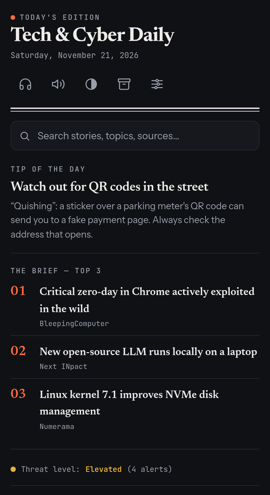

# Tech & Cyber Daily

A daily tech, cybersecurity and AI magazine for PC and Android. I got tired of hopping across fifteen ad-filled sites with cookie banners just to read three stories that actually matter — so I built my own.

The app pulls articles from **27 outlets** (French and English), drops anything that isn't tech, strips the ads, translates non-English stories into your chosen language (EN/FR picker in Settings), and lays it out like a magazine. Articles open **inside the app** — no redirect to a slow website. No account, no ads, no tracking.



Light theme: [docs/screenshot-light.png](docs/screenshot-light.png). Screenshots use sample articles.

## Features

The core is the magazine of the day: the last 24 hours of news, sorted, cleaned, translated, with a cover image and the full text readable right away. Filtering is aggressive — if a story is about Amazon deals or politics, it's out.

Around that, the reading comforts:

- search by keyword, topic or source;
- **tracked topics**: mark "ransomware" or "Apple" and matching stories float to the top, highlighted;
- **saved stories** readable offline, read stories dimmed, estimated reading time;
- a one-line **summary (TL;DR)** at the top of each article;
- a **tap-to-define glossary**: tap a technical term, get a plain-English definition;
- **podcast mode** (hands-free chained voice reading) and read-aloud for a single article;
- light/dark theme, 7-day archives, sharing.

Since it's cyber-oriented, there's extra seasoning: a **threat alert** that surfaces critical stories (zero-days, ransomware, exploited flaws), a **threat level for the day**, a small **security quiz** and the tip of the day.

The app checks for its own updates and shows a banner when a new version is out — it never downloads anything on its own.

## Install

### Windows

Grab **[`TechCyberDaily.exe`](../../releases/latest)**, double-click it, and today's magazine opens in your browser. Optional: `powershell -File pc\TechCyberDaily.ps1 -Lang fr` to generate the French edition directly. On first run Windows will complain via SmartScreen (normal, the exe isn't signed) → *More info* → *Run anyway*.

To have it open by itself every morning, run `pc/enable-autostart.ps1` (right-click → Run with PowerShell). `pc/disable-autostart.ps1` removes the scheduled task.

### Android

Download **[`TechCyberDaily.apk`](../../releases/latest)** on the phone, open it, and allow installs from unknown sources when Android asks. Play Protect will warn (normal, the app isn't on the Play Store) → *Install anyway*. Requires Android 7.0+.

### Linux

Take the **`.AppImage`** from the [latest release](../../releases/latest), make it executable and run it:

```bash
chmod +x TechCyberDaily-x86_64.AppImage
./TechCyberDaily-x86_64.AppImage
```

The magazine opens in the browser. You only need `python3`, which ships with most distros.

### iPhone

The `.ipa` in the release is **unsigned**. To install it, re-sign it with your own Apple ID through a sideloading tool — allowed in the EU under the DMA:

1. install [AltStore](https://altstore.io) (or Sideloadly) on your computer;
2. plug in the iPhone, open AltStore, sign in with your Apple ID (a free account is enough);
3. install `TechCyberDaily-unsigned.ipa` → AltStore re-signs it and installs it on the phone.

With a free Apple ID you have to re-install every 7 days. A developer account ($99/year) lasts a year.

## Build it yourself

**PC** — nothing to install, the C# compiler ships with Windows:

```powershell
pc\build_exe.ps1
```

**Android** — you need a JDK 17 and the Android SDK (build-tools 34). No Gradle: the build is done by hand with `aapt` + `d8` + `apksigner`:

```powershell
android\build_apk.ps1
```

The signing key (`techcyber.jks`) is deliberately not in the repo — the script generates one on first build.

**Linux and iOS** build on Linux and macOS. Since I don't have either at hand, the repo ships two **GitHub Actions** recipes that build them for free on GitHub's servers (Actions tab → *Run workflow*, or automatically when a `v*` tag is pushed). Locally it would be `linux/build_appimage.sh` on Linux and `cd ios && xcodegen generate` on a Mac.

## How it works

Stories are fetched **directly** from the outlets' public RSS feeds, no intermediary server. On PC it's PowerShell; on Android a native Java bridge works around the browser's CORS restrictions and handles character encodings by hand. Each article's full text is extracted from its original page, stripped of ads, and shown in the built-in reader. Translation uses Google Translate's public free endpoint.

Nothing is stored anywhere but on your device.

## Repo layout

```
pc/           PC version: a PowerShell script (the engine) + the .exe build
android/      Android version: a WebView + a native Java bridge, built into an .apk
linux/        AppImage recipe
ios/          iOS recipe (Swift WebView)
version.json  published version, used for the in-app update check
```

## Note

Personal project, provided as-is. Articles remain the property of their outlets — every story keeps a link to its source. The app only aggregates and formats public feeds for private use.

## License

[MIT](LICENSE) — do whatever you want with it.
